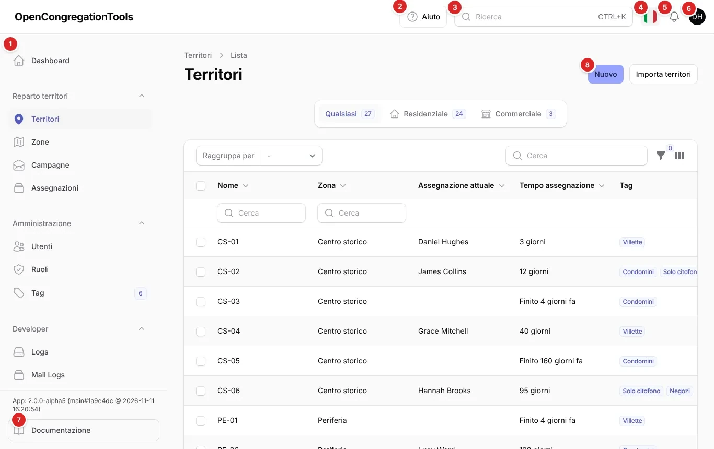
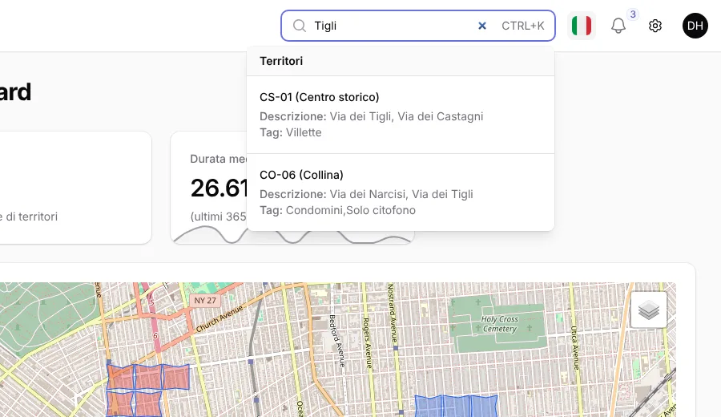
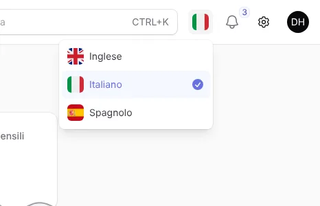
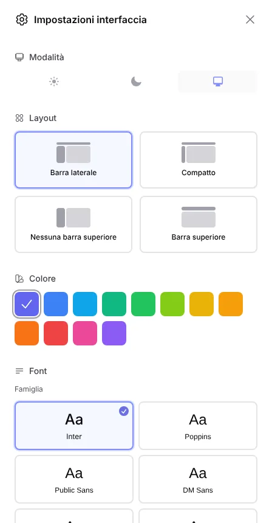
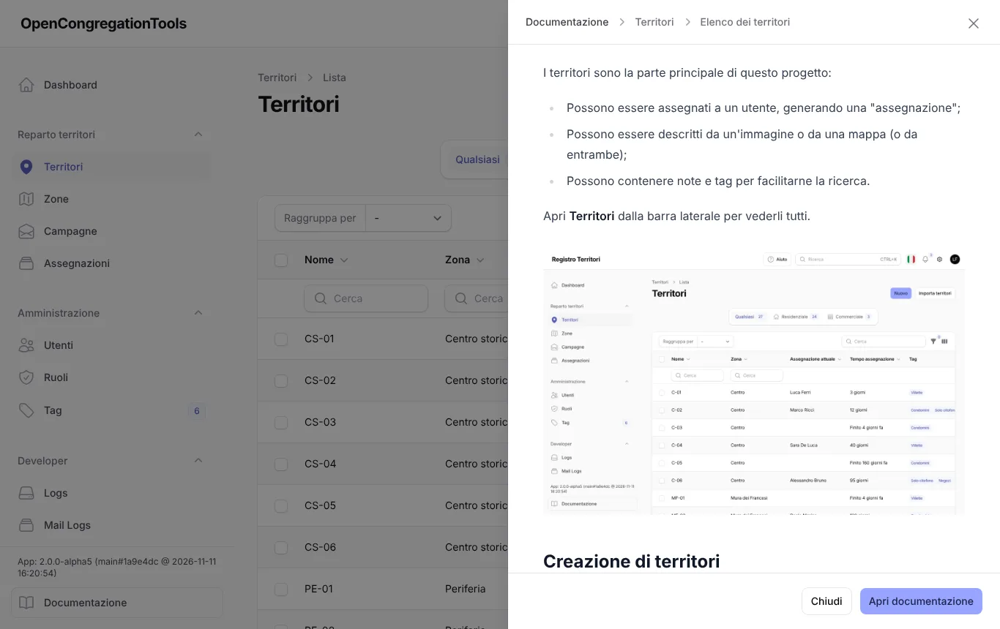
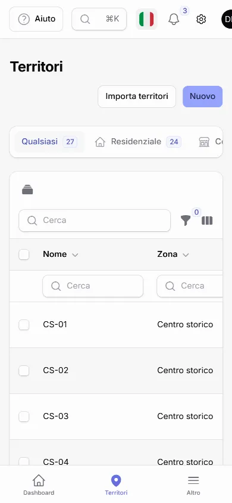

Tutte le pagine dell'applicazione condividono la stessa struttura.

1. **Barra laterale**: il menu, diviso in gruppi. Vedi solo le voci che il tuo ruolo ti permette di usare.
   - **Reparto territori**: Territori, Zone, Campagne e Assegnazioni;
   - **Testimonianza pubblica**: Poster e Depositi;
   - **Pubblicazioni**: Pubblicazioni periodiche, Richieste ed Elenco pubblicazioni;
   - **Amministrazione**: Utenti, Ruoli, Reparti, Tag e Impostazioni;
   - **Sviluppatore**: i log dell'applicazione, delle email inviate e delle modifiche effettuate.

   Un numero accanto a una voce segnala qualcosa da controllare: accanto a **Campagne** (arancione) le campagne che
   terminano entro 7 giorni, accanto ad **Assegnazioni** (rosso) i territori ancora fuori per una campagna terminata,
   accanto a **Richieste** (arancione) le richieste di pubblicazioni ancora da ordinare o prendere.
2. **Aiuto**: apre in un pannello laterale la pagina di questa guida che spiega la schermata corrente.
3. **Ricerca globale**: cerca contemporaneamente tra territori, zone, campagne e altro (vedi sotto).
4. **Lingua**: cambia la lingua dell'interfaccia (inglese, italiano o spagnolo).
5. **Notifiche**: la campanella mostra il numero di notifiche non lette (vedi [Notifiche](notifications)).
6. **Menu utente**: il tuo [profilo](profile), l'aspetto dell'interfaccia (vedi sotto), **Installa app** (vedi
   [Installare l'app](#installare-lapp)), **Informazioni** (la versione dell'applicazione, più quelle di
   Laravel, Filament e PHP fuori dalla produzione, e il pulsante **Segnala un bug**) e il pulsante **Disconnetti**.
7. **Documentazione**: apre questa guida.
8. **Azioni della pagina**: i pulsanti principali della pagina corrente (es. **Nuovo**).

## Ricerca globale

Clicca il campo di ricerca (oppure premi <kbd>Ctrl</kbd>+<kbd>K</kbd>, <kbd>⌘</kbd>+<kbd>K</kbd> su Mac) e inizia a
scrivere. La ricerca guarda in:

- **territori**: nome, descrizione, zona, note e tag;
- **zone**, **campagne**, **tag**, **ruoli**, **pubblicazioni** e **depositi**: nome;
- **poster**: titolo e codice.

Trovi solo ciò che il tuo ruolo ti permette di vedere.

Clicca un risultato per aprirlo.

## Cambiare lingua

Clicca la bandiera nella barra in alto e scegli una lingua. La scelta viene ricordata dal browser. La lingua delle email
che ricevi si imposta invece nel tuo [profilo](profile).

## Personalizzare l'aspetto

Apri il menu utente (le tue iniziali in alto a destra) e clicca **Impostazioni interfaccia**: si apre un pannello in
cui ogni utente può personalizzare l'interfaccia. Le scelte vengono salvate nel browser:

- **Modalità**: chiara, scura o come il sistema;
- **Layout**: barra laterale, barra laterale compatta, senza barra superiore o con menu in alto;
- **Colore**: il colore principale;
- **Carattere**: famiglia e dimensione del carattere, e la **densità** dell'interfaccia.

## Pannello di aiuto

Nelle pagine collegate a questa guida, il pulsante **Aiuto** apre la documentazione relativa in un pannello laterale,
senza lasciare la pagina. Clicca **Apri documentazione** per leggerla per intero.

## Tabelle

La maggior parte delle pagine mostra una tabella. Tutte le tabelle funzionano allo stesso modo:

- clicca l'**intestazione di una colonna** per ordinare;
- usa il campo **Cerca** sopra la tabella, o i campi di ricerca sotto alcune intestazioni, per filtrare le righe;
- il pulsante dei **filtri** (icona a imbuto) apre i filtri disponibili; il numero indica quanti sono attivi;
- il pulsante **Colonne** permette di mostrare o nascondere le colonne facoltative;
- spunta le **caselle** a sinistra per selezionare le righe ed eseguire su di esse le **azioni di massa**;
- il selettore **per pagina** in fondo cambia il numero di righe mostrate.

## Modifiche non salvate

Se provi a lasciare una pagina con modifiche non salvate, l'applicazione chiede una conferma.

## Da smartphone

Sugli schermi piccoli la barra laterale è sostituita da una **barra di navigazione in basso**. Tocca **Altro** per
raggiungere le altre voci del menu. Moduli e finestre si aprono come pannelli laterali, più comodi da usare con il dito.
Le tabelle mostrano ogni riga come una scheda, con le informazioni principali in alto e sotto le altre colonne, scelte
con il pulsante **Colonne**; per ordinarle usa il menu **Ordina per**.

## Installare l'app

Installare l'applicazione sullo smartphone o sul computer è il modo consigliato per usarla: la apri dalla schermata
Home o dal desktop, in una sua finestra, come qualsiasi altra app. Su iPhone e iPad serve anche per ricevere le
[notifiche push](notifications#notifiche-push).

Subito dopo l'accesso, una pagina a schermo intero propone di installarla:

- su **Android** e in **Chrome** o **Edge** sui computer, clicca **Installa** e conferma;
- su **iPhone** e **iPad**, tocca il pulsante **Condividi** di Safari, poi **Aggiungi alla schermata Home**.

Clicca **Non ora** per chiuderla: viene riproposta dopo 30 giorni. Non è mostrata se l'app è già installata, o se il
browser non può installarla (es. Firefox, o Safari sui computer).

Per installarla in seguito, clicca **Installa app** nel menu utente, oppure **Installa** nella sezione
**Installa l'app** del tuo [profilo](profile). Entrambi compaiono solo quando il browser può installare l'applicazione.
