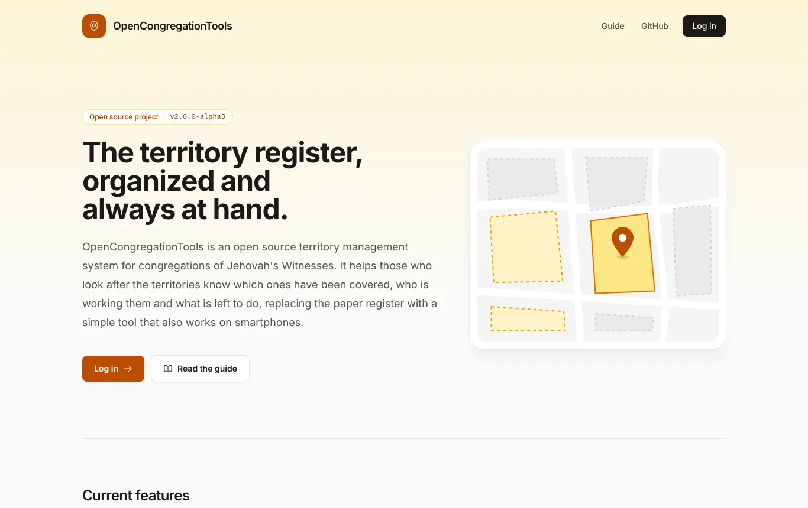
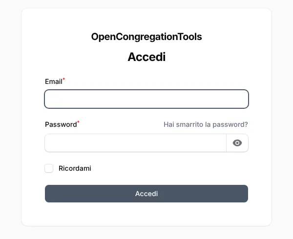
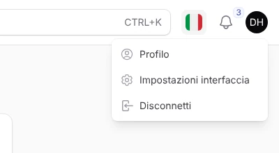

La home page dell'applicazione descrive il progetto e contiene tre link: **Guida** (questa documentazione),
**GitHub** (il codice sorgente) e **Accedi**.

## Accedere

1. Clicca **Accedi** (oppure apri direttamente `/app/login`).
2. Inserisci **Email** e **Password**.
3. Spunta **Ricordami** se usi un dispositivo personale, poi clicca **Accedi**.

> ℹ️ **Nota:** gli account vengono creati da un amministratore: non è possibile registrarsi da soli. Se non hai un
> account, chiedilo a chi gestisce i territori nella tua congregazione.

## Password dimenticata

Clicca **Hai smarrito la password?** nella pagina di accesso, inserisci la tua email e segui il link che riceverai per
scegliere una nuova password.

## Chi può accedere

Possono accedere solo gli utenti con **Permetti accesso** attivo. Gli altri sono *utenti virtuali*: possono ricevere
territori, ma non possono aprire l'applicazione (vedi [Utenti](../administration/users)).

## Uscire

Apri il menu utente (le tue iniziali in alto a destra) e clicca **Disconnetti**.

## Leggere la documentazione senza accedere

Questa guida è disponibile all'indirizzo `/knowledge-base` e può essere letta da chiunque, anche senza account.
