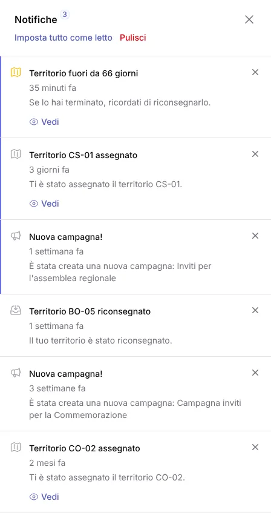

L'applicazione ti informa degli eventi che ti riguardano, sia **all'interno dell'applicazione** (la campanella nella
barra in alto) sia **via email**, nella lingua scelta nel tuo [profilo](profile).

## Quando ricevi una notifica

| Evento | Chi viene avvisato |
|--------|--------------------|
| **Territorio assegnato** | la persona che ha ricevuto il territorio |
| **Territorio riconsegnato** | la persona che aveva il territorio |
| **Nuova campagna** | tutti gli utenti che possono accedere |
| **Territorio fuori da *N* giorni** | chi ha un territorio da più di 60 giorni. Il promemoria viene inviato ogni lunedì finché il territorio non viene riconsegnato. |

## Gestire le notifiche

- Clicca la **campanella** per aprire il pannello. Le notifiche non lette sono evidenziate e contate sulla campanella.
- Clicca **Vedi** per aprire il territorio o l'assegnazione collegata.
- Clicca **×** per rimuovere una singola notifica.
- **Imposta tutto come letto** e **Pulisci** agiscono su tutte le notifiche.

> ℹ️ **Nota:** le email vengono inviate in background. Se arrivano in ritardo, chiedi all'amministratore di verificare
> che le attività pianificate siano configurate (vedi la [Guida al setup](../setup)).
