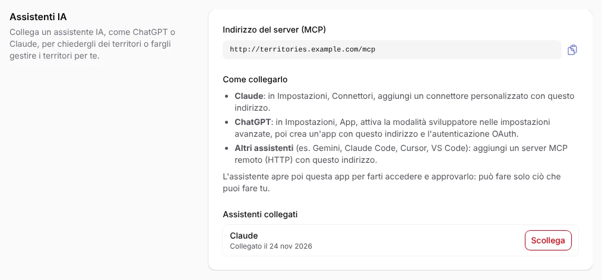

Apri il menu utente (le tue iniziali in alto a destra) e clicca **Profilo**.

## Informazioni del profilo

- **Foto**: clicca **Seleziona una nuova foto** per caricare un'immagine del profilo, mostrata al posto delle iniziali.
- **Nome**, **Cognome** ed **Email**.
- **Lingua preferita**: la lingua delle email e delle notifiche che ricevi.

Clicca **Salva** per applicare le modifiche.

## Informazioni di contatto

Qui puoi indicare i contatti da chiamare in caso di necessità, ad esempio un contatto di emergenza. Gli amministratori
possono vederli dalla pagina dell'utente (vedi [Utenti](../administration/users)).

Per aggiungere un contatto:

1. Clicca **Aggiungi contatto**.
2. Scegli il **Tipo**: *Personale*, *Emergenza*, *Aziendale* o *Altro*.
3. Attiva **Contatto principale** se è il contatto principale per quel tipo.
4. Compila il **Nome** e almeno un **Numero di telefono** o un **Indirizzo**, più eventuali **Note**.
5. Clicca **Invia**.

Usa **Visualizza**, **Modifica** ed **Elimina** accanto a ogni contatto per gestirlo. Visualizzando un contatto, i
pulsanti **Chiama** e **Apri in Maps** avviano una telefonata o aprono l'indirizzo nell'app delle mappe.

## Installa l'app

Clicca **Installa** per installare l'applicazione su questo dispositivo e aprirla come qualsiasi altra app (vedi
[Installare l'app](interface#installare-lapp)). La sezione compare solo quando il browser può installarla, e indica
quando l'applicazione è già installata.

## Notifiche push

Ricevi le notifiche anche su questo dispositivo, pure ad applicazione chiusa: clicca **Attiva su questo dispositivo**.
Vedi [Notifiche](notifications#notifiche-push).

## Assistenti IA

Collega un assistente IA, come ChatGPT, Claude o Gemini, per chiedergli dei territori (es. *"Quali territori non sono
stati percorsi da sei mesi?"*) o per fargli assegnare e restituire i territori per te. La sezione compare solo quando
gli amministratori consentono gli assistenti IA (vedi [Impostazioni](../administration/settings#sicurezza)).

1. Copia l'**Indirizzo del server (MCP)** con il pulsante accanto.
2. Aggiungilo al tuo assistente:
    - **Claude**: in *Impostazioni*, *Connettori*, aggiungi un connettore personalizzato con questo indirizzo;
    - **ChatGPT**: in *Impostazioni*, *App*, attiva la modalità sviluppatore nelle impostazioni avanzate, poi crea
      un'app con questo indirizzo e l'autenticazione OAuth;
    - **altri assistenti** (es. Gemini, Claude Code, Cursor, VS Code): aggiungi un server MCP remoto (HTTP) con questo
      indirizzo.
3. L'assistente apre questa applicazione: accedi, controlla il nome dell'assistente e il sito su cui tornerai, poi
   clicca **Approva**.

L'assistente può leggere e fare solo ciò che puoi fare tu nell'applicazione, e ti chiede conferma prima di modificare
qualcosa. **Assistenti collegati** elenca quelli che hai approvato: clicca **Scollega** per togliere l'accesso a uno di
loro, che dovrà poi essere approvato di nuovo.

> ⚠️ **Attenzione:** ciò che l'assistente legge (es. i nomi dei proclamatori) viene inviato all'azienda che lo fornisce.
> Chiedigli solo ciò che ti serve.

## Aggiorna password

Inserisci la **Password attuale**, poi due volte la **Nuova password** e clicca **Salva**. Usa una password lunga e
casuale: deve avere almeno 12 caratteri e non deve comparire in fughe di dati note. Le stesse regole valgono quando
scegli la password dall'invito o con **Hai smarrito la password?**.

## Autenticazione a due fattori

Proteggi il tuo account con un codice di un'app di autenticazione sul telefono (ad esempio Google Authenticator,
Microsoft Authenticator o Authy), chiesto dopo la password a ogni accesso.

1. In **App di autenticazione**, clicca **Configurazione**.
2. Inquadra il codice QR con l'app di autenticazione (o inserisci la chiave mostrata sotto).
3. Salva i **codici di recupero** in un posto sicuro: ognuno ti permette di accedere una volta se perdi il telefono.
4. Inserisci il codice di 6 cifre mostrato dall'app per confermare.

Da allora puoi **Rigenerare i codici di recupero** o **Disabilitare** l'autenticazione a due fattori dalla stessa
sezione. Se gli amministratori la richiedono (vedi [Impostazioni](../administration/settings#sicurezza)), ti viene
chiesto di configurarla prima di usare l'applicazione, e non puoi usarla senza.

## Sessioni del browser

Elenca i dispositivi su cui hai effettuato l'accesso. Clicca **Disconnetti altre sessioni del browser** (e conferma con
la tua password) se hai usato un computer condiviso o pensi che qualcun altro abbia usato il tuo account.

## Elimina account

Elimina definitivamente il tuo account. L'operazione non può essere annullata.

> ⚠️ **Attenzione:** l'utente root (il primo utente creato durante l'installazione) non può mai essere eliminato.
