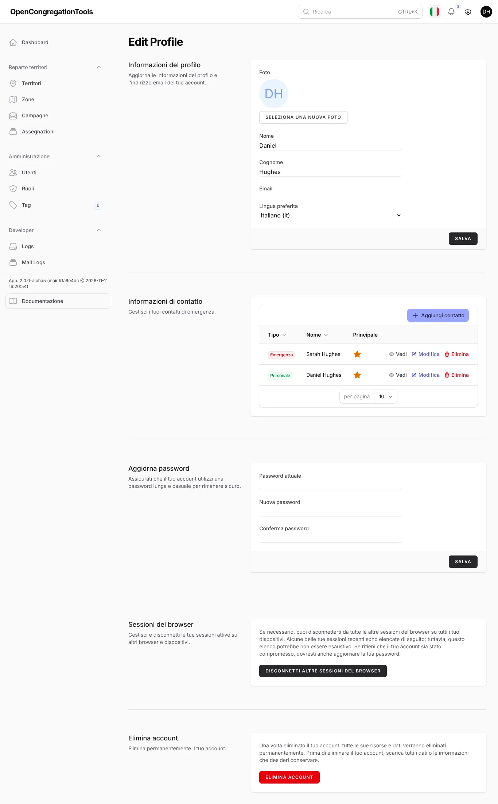
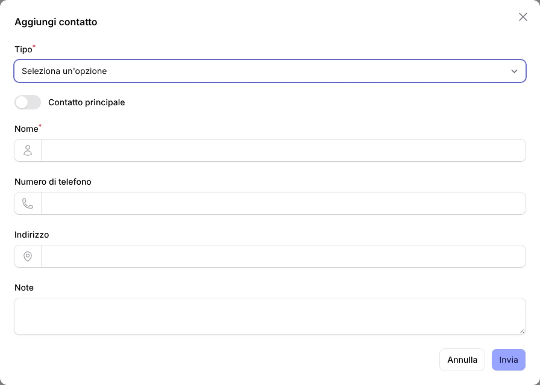

Apri il menu utente (le tue iniziali in alto a destra) e clicca **Profilo**.

## Informazioni del profilo

- **Foto**: clicca **Seleziona una nuova foto** per caricare un'immagine del profilo, mostrata al posto delle iniziali.
- **Nome**, **Cognome** ed **Email**.
- **Lingua preferita**: la lingua delle email e delle notifiche che ricevi.

Clicca **Salva** per applicare le modifiche.

## Informazioni di contatto

Qui puoi indicare i contatti da chiamare in caso di necessità, ad esempio un contatto di emergenza. Gli amministratori
possono vederli dalla pagina dell'utente (vedi [Utenti](../administration/users)).

Per aggiungere un contatto:

1. Clicca **Aggiungi contatto**.
2. Scegli il **Tipo**: *Personale*, *Emergenza*, *Aziendale* o *Altro*.
3. Attiva **Contatto principale** se è il contatto principale per quel tipo.
4. Compila il **Nome** e almeno un **Numero di telefono** o un **Indirizzo**, più eventuali **Note**.
5. Clicca **Invia**.

Usa **Visualizza**, **Modifica** ed **Elimina** accanto a ogni contatto per gestirlo. Visualizzando un contatto, i
pulsanti **Chiama** e **Apri in Maps** avviano una telefonata o aprono l'indirizzo nell'app delle mappe.

## Aggiorna password

Inserisci la **Password attuale**, poi due volte la **Nuova password** e clicca **Salva**. Usa una password lunga e
casuale.

## Sessioni del browser

Elenca i dispositivi su cui hai effettuato l'accesso. Clicca **Disconnetti altre sessioni del browser** (e conferma con
la tua password) se hai usato un computer condiviso o pensi che qualcun altro abbia usato il tuo account.

## Elimina account

Elimina definitivamente il tuo account. L'operazione non può essere annullata.

> ⚠️ **Attenzione:** l'utente root (il primo utente creato durante l'installazione) non può mai essere eliminato.
