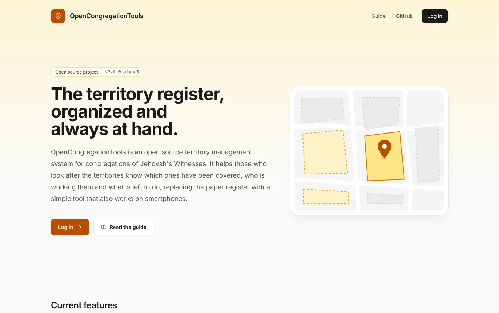

# OpenCongregationHelper

Questo progetto mira a creare un sistema di gestione dei territori **Open Source** per i **Testimoni di Geova**.

Sostituisce il registro cartaceo dei territori: tiene traccia di quali territori esistono, chi li
sta lavorando, da quando e quali sono stati percorsi. Funziona nel browser, anche da smartphone.

> 💡 **Provalo:** la [demo pubblica](https://ochdemo.altervista.org) usa l'ultima versione con dati di prova. Chiunque
> può accedervi come amministratore e i suoi dati vengono azzerati ogni notte: non inserire mai nomi o indirizzi reali.

## Concetti chiave

| Concetto | Cos'è |
|----------|-------|
| **Territorio** | Un'area da lavorare, identificata da un nome (es. `CS-01`). Può avere una mappa disegnata su OpenStreetMap, un'immagine (es. la scansione della cartolina cartacea), note e tag. Un territorio è *residenziale* o *commerciale*. |
| **Zona** | Un gruppo di territori (es. un quartiere). Ogni zona ha un colore, usato nella mappa della dashboard. Il nome di un territorio è unico all'interno della stessa zona. |
| **Assegnazione** | Il fatto che un territorio sia stato affidato a una persona, con una data di inizio e, una volta riconsegnato, una data di fine. Un territorio può avere una sola assegnazione in corso alla volta. Tutte le assegnazioni passate ne formano lo storico. |
| **Campagna** | Un'etichetta facoltativa per le assegnazioni fatte durante un'attività speciale (es. gli inviti per la Commemorazione), con date di validità e statistiche di avanzamento. |
| **Utente** | Una persona registrata nell'applicazione. Gli utenti possono essere *virtuali* (ricevono territori ma non possono accedere) oppure avere accesso all'applicazione con uno o più **ruoli**. |

## Come è organizzata questa guida

- **Nozioni di base**: accesso, interfaccia, dashboard, profilo e notifiche.
- **Territori**: consultare, creare, mappare e importare i territori, e organizzarli in zone.
- **Assegnazioni**: assegnare e riconsegnare i territori, lo storico, la condivisione delle assegnazioni e le campagne.
- **Amministrazione**: utenti, ruoli e permessi, e tag.
- **Guide**: procedure passo passo per le attività più comuni.

> 💡 **Suggerimento:** mentre usi l'applicazione, il pulsante **Aiuto** nella barra in alto (dove disponibile) apre la
> pagina di questa guida che descrive la schermata corrente. Il pulsante **Documentazione** in fondo alla barra laterale
> apre l'intera guida, consultabile anche senza effettuare l'accesso.

## Come posso contribuire?

- Segnala bug o suggerisci nuove funzionalità tramite la sezione [Issues](https://github.com/OpenCHelper/OpenCongregationHelper/issues):
  per segnalare un bug dall'applicazione, apri il menu utente, clicca **Informazioni** e poi **Segnala un bug**, che
  compila per te i dettagli della tua installazione;
- Se possiedi le competenze di programmazione necessarie, puoi contribuire inviando delle [Pull Request](https://github.com/OpenCHelper/OpenCongregationHelper/pulls);
- Aiuta a tradurre l'interfaccia utente in altre lingue o a migliorare quelle esistenti.

Il codice completo è disponibile sul suo [repository ufficiale di GitHub](https://github.com/OpenCHelper/OpenCongregationHelper).
