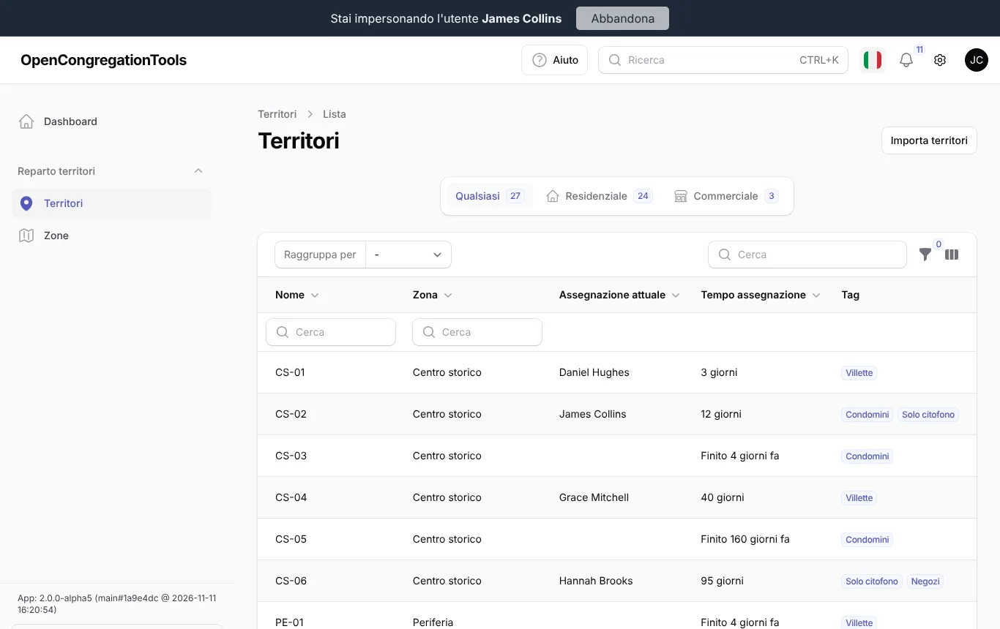

Se hai ricevuto un account per vedere i tuoi territori, ecco cosa ti serve sapere. A seconda dei permessi concessi dalla
tua congregazione, alcune voci del menu potrebbero non esserci.

## Trovare i tuoi territori

- L'elenco **Territori** mostra tutti i territori, con chi li sta lavorando. Clicca un territorio per vederne la mappa o
  l'immagine.
- Le **notifiche** (icona a campanella) ti avvisano quando ti viene assegnato un territorio e ti ricordano quando lo hai
  da molto tempo. Le ricevi anche via email.

## Usare la mappa

Nella pagina del territorio, la scheda **Mappa** mostra i confini del territorio su una mappa interattiva: aumenta lo
zoom per leggere i nomi delle vie e usa il pulsante **schermo intero** per vederla meglio sullo smartphone.

## Riconsegnare un territorio

Quando hai finito, apri la pagina dell'assegnazione (es. dalla sua notifica), clicca **Chiedi di riconsegnare** e
conferma: il reparto territori riceve una notifica e chiude l'assegnazione. Se il tuo ruolo lo permette, puoi invece
cliccare **Termina assegnazione** nella stessa pagina (o nella pagina del territorio) per riconsegnarlo subito.

Se il territorio ti è stato assegnato per una campagna terminata, o che termina entro 7 giorni, la pagina
dell'assegnazione mostra un promemoria per riconsegnarlo.

## Tenere aggiornati i tuoi dati

Dal tuo [profilo](../basics/profile) puoi cambiare la password, scegliere la lingua delle email e aggiungere un contatto
di emergenza.

## Usarla dallo smartphone

L'applicazione funziona nel browser del telefono: apri il suo indirizzo, accedi e usa la barra in basso per spostarti
tra le pagine. Gli elenchi mostrano ogni elemento come una scheda. Dal menu del browser puoi aggiungerla alla schermata
Home per aprirla come un'app.
