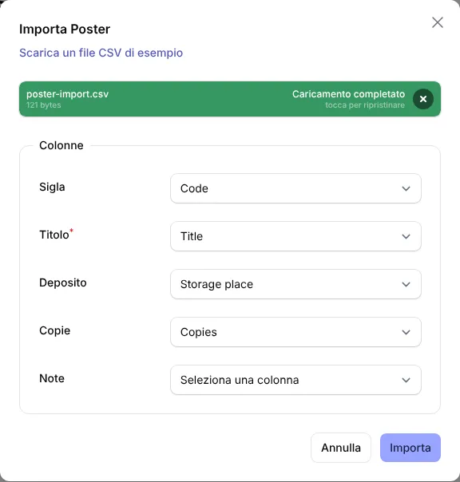
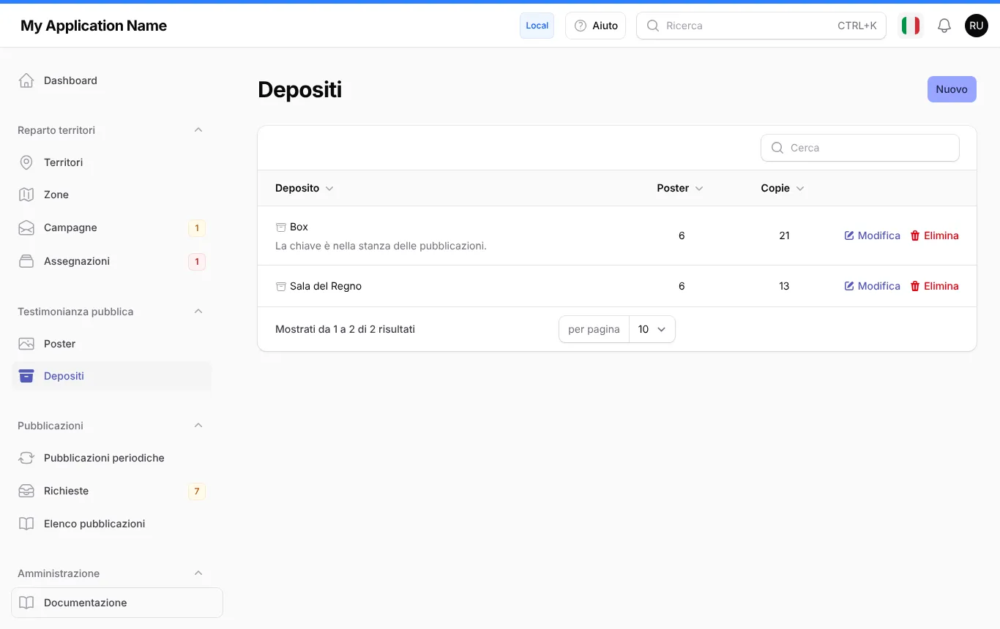

Apri **Testimonianza pubblica → Poster** per vedere l'inventario dei poster magnetici dei carrelli e degli espositori:
la **Sigla**, il **Titolo** e quante copie sono conservate in ogni deposito (ad esempio la *Sala del Regno* o un *box*).

La tabella ha una colonna per ogni deposito e una colonna **Totale**, in rosso quando non resta nessuna copia. La riga
**Riepilogo** in fondo somma le copie dei poster mostrati. Usa i filtri per vedere i poster **Conservato in** un deposito,
oppure solo quelli **Disponibili** o **Esauriti**.

## Aggiungere o modificare un poster

1. Clicca **Nuovo** (o **Modifica** su un poster esistente).
2. Inserisci la **Sigla** (facoltativa, es. `mi-25`) e il **Titolo** nella tua lingua; puoi inserirlo anche nelle
   altre lingue, altrimenti mostrano quello che hai scritto.
3. In **Quantità**, scegli un **Deposito** e inserisci il numero di **Copie**. Clicca **Aggiungi deposito** per aggiungere le
   copie conservate in un altro posto. Per creare al volo un nuovo deposito, clicca **+** accanto al campo.
4. Se vuoi, carica un'**Immagine** del poster per riconoscerlo a colpo d'occhio.
5. Clicca **Salva**.

## Importare ed esportare i poster

Per caricare molti poster in una volta, ad esempio da un foglio di calcolo che hai già, apri **Importa / Esporta →
Importa Poster** in alto nella pagina e carica un file CSV con una riga per ogni poster e deposito:

| Sigla | Titolo | Deposito | Copie | Note |
|-------|--------|----------|-------|------|
| mi-25 | Vivi felice per sempre! | Sala del Regno | 2 | |
| mi-25 | Vivi felice per sempre! | Box | 3 | |

Serve solo il **Titolo**; **Scarica un file CSV di esempio** nella finestra fornisce un file da cui partire. Le colonne
vengono riconosciute dal loro nome, nella lingua dell'interfaccia o in inglese (es. *Sigla*, *Titolo*, *Deposito*,
*Copie*); controllale in **Colonne** (una colonna con un altro nome si può sempre scegliere a mano), poi clicca
**Importa**. Una notifica avvisa quando l'importazione è terminata, con le righe che non è stato possibile importare.

- Le righe con la stessa **Sigla** (o con lo stesso **Titolo**, se non c'è la sigla) sono lo stesso poster: importando
  di nuovo il file si aggiornano i poster e le loro copie invece di duplicarli.
- Le **Copie** di una riga sostituiscono quelle di quel deposito; i depositi che non esistono ancora vengono creati.
- I **Titoli** vengono salvati nella **Lingua dei titoli** scelta nella finestra (la tua lingua, se non la cambi): le
  traduzioni nelle altre lingue vengono conservate.

Per salvare l'elenco dei poster, ad esempio per tenerne una copia o modificarlo in un foglio di calcolo, apri **Importa
/ Esporta → Esporta Poster**, scegli le colonne e la **Lingua dei titoli**, poi clicca **Esporta**. Una notifica
fornisce il file, in CSV o Excel, quando è pronto: ha le stesse colonne dell'importazione, con una riga per ogni poster
e deposito, così si può importare di nuovo.

## Depositi

Clicca **Depositi** in alto nella pagina (o **Testimonianza pubblica → Depositi**) per gestire i posti in cui sono
conservati i poster, con delle note facoltative (ad esempio dove si trova la chiave). Ogni deposito mostra quanti poster
e quante copie contiene. Eliminando un deposito si eliminano anche le quantità dei poster conservati lì.

Sono solo i posti in cui il materiale è **conservato**, non le postazioni in cui si montano i carrelli.

Anche i depositi si possono importare ed esportare, da **Importa / Esporta** nella loro pagina, con una riga per ognuno
(*Nome*, *Note*): importando un nome che esiste già se ne aggiornano le note.

I membri del [reparto Testimonianza pubblica](../administration/departments) possono gestire i poster e i depositi.
