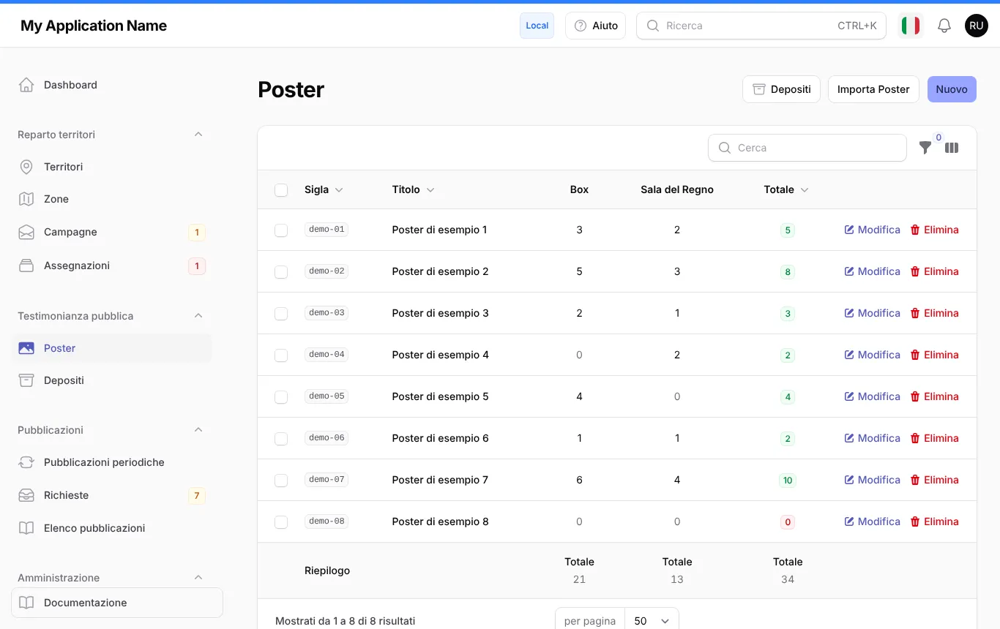
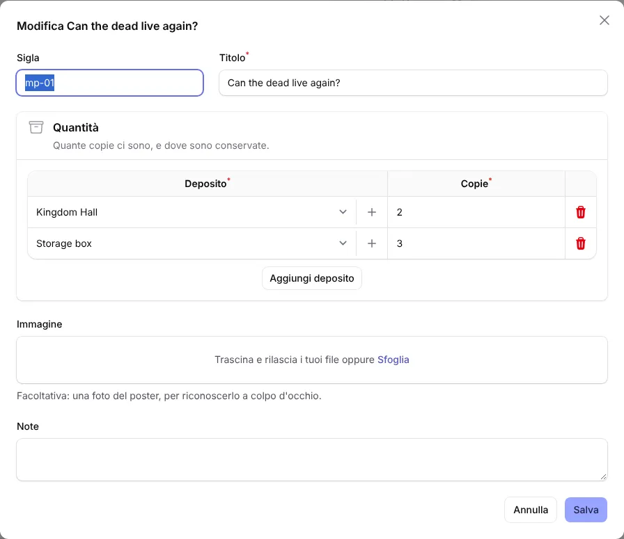

Apri **Testimonianza pubblica → Poster** per vedere l'inventario dei poster magnetici dei carrelli e degli espositori:
la **Sigla**, il **Titolo** e quante copie sono conservate in ogni luogo (ad esempio la *Sala del Regno* o un *box*).

La tabella ha una colonna per ogni luogo e una colonna **Totale**, in rosso quando non resta nessuna copia. La riga
**Riepilogo** in fondo somma le copie dei poster mostrati. Usa i filtri per vedere i poster **Conservato in** un luogo,
oppure solo quelli **Disponibili** o **Esauriti**.

## Aggiungere o modificare un poster

1. Clicca **Nuovo** (o **Modifica** su un poster esistente).
2. Inserisci la **Sigla** (facoltativa, es. `mi-25`) e il **Titolo**.
3. In **Quantità**, scegli un **Luogo** e inserisci il numero di **Copie**. Clicca **Aggiungi luogo** per aggiungere le
   copie conservate in un altro posto. Per creare al volo un nuovo luogo, clicca **+** accanto al luogo.
4. Se vuoi, carica un'**Immagine** del poster per riconoscerlo a colpo d'occhio.
5. Clicca **Crea** (o **Salva**).

## Luoghi

Clicca **Luoghi** in alto nella pagina (o **Testimonianza pubblica → Luoghi**) per gestire i posti in cui sono
conservati i poster, con delle note facoltative (ad esempio dove si trova la chiave). Ogni luogo mostra quanti poster e
quante copie contiene. Eliminando un luogo si eliminano anche le quantità dei poster conservati lì.

I membri del [reparto Testimonianza pubblica](../administration/departments) possono gestire i poster e i luoghi.
