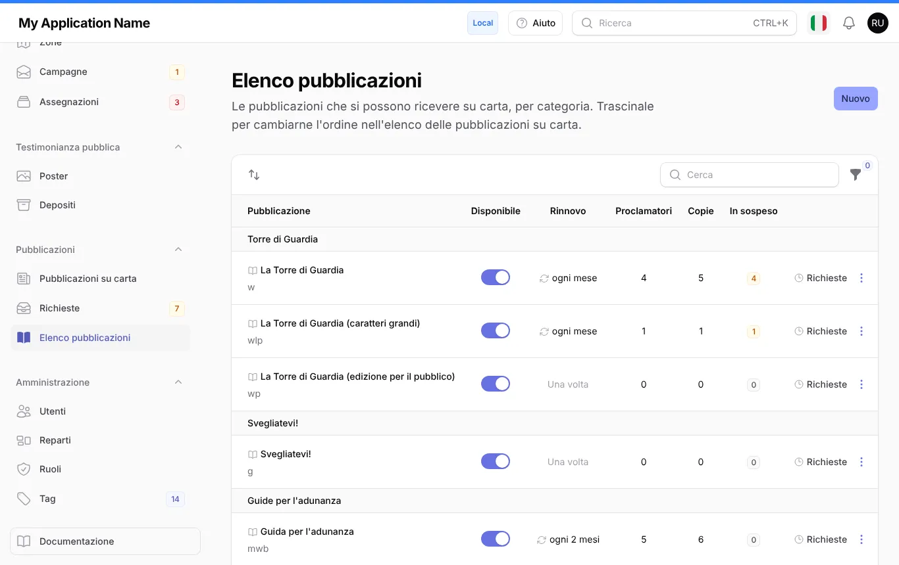

Apri **Pubblicazioni → Pubblicazioni periodiche** per vedere chi riceve regolarmente pubblicazioni su carta (ad esempio
*La Torre di Guardia* o la *Guida per l'adunanza*), e quante copie. Ognuna viene [richiesta](requests) di nuovo
automaticamente ogni periodo (es. ogni mese), e ogni richiesta resta nello storico.

C'è una riga per ogni proclamatore e una colonna per ogni pubblicazione (**—** se non la riceve), raggruppate per
categoria. I riquadri in alto e la riga **Riepilogo** in fondo mostrano il **totale delle copie da ordinare** di ogni
pubblicazione e quanti proclamatori la ricevono. Usa il filtro **Riceve** per vedere solo chi riceve una pubblicazione:
i totali seguono i filtri e la ricerca.

## Aggiungere un proclamatore

1. Clicca **Aggiungi proclamatore**.
2. Scegli il **Proclamatore** (sono elencati solo quelli non ancora presenti).
3. In **Copie ricevute**, clicca **Aggiungi pubblicazione**, scegli la **Pubblicazione** (solo quelle che si
   rinnovano, raggruppate per categoria; puoi scrivere per cercarla) e inserisci il numero di **Copie**. Ripeti per ogni
   pubblicazione ricevuta: ne serve almeno una. La prima richiesta di ognuna viene fatta subito.
4. Se vuoi, aggiungi delle **Note** (ad esempio chi gliele consegna).
5. Clicca **Salva**, oppure **Salva & crea un altro** per aggiungere più proclamatori di seguito.

Per cambiare le copie clicca **Modifica**: cambia i numeri (valgono per le prossime richieste), aggiungi una
pubblicazione o toglila col cestino (non verrà più richiesta). Quando un proclamatore non riceve più nulla, clicca
**Rimuovi**: le sue pubblicazioni non vengono più richieste, ma il suo storico viene conservato e potrai aggiungerlo di
nuovo in seguito. Il pulsante **Richieste** apre lo storico delle sue richieste.

## L'elenco delle pubblicazioni

Le pubblicazioni che si possono ricevere non sono fisse: apri **Pubblicazioni → Elenco pubblicazioni** per aggiungerle,
rinominarle o eliminarle. L'elenco parte con i periodici, già tradotti in ogni lingua: *La Torre di Guardia* (anche a
caratteri grandi e nell'edizione per il pubblico), *Svegliatevi!* e la *Guida per l'adunanza* (anche a caratteri
grandi). Come ogni altra pubblicazione si possono modificare, disattivare o eliminare (una volta eliminati non vengono
ricreati).

1. Clicca **Nuovo** e inserisci il **Nome** nella tua lingua (es. *Vivi felice per sempre!*): puoi inserirlo anche
   nelle altre lingue, altrimenti mostrano quello che hai scritto.
2. Scegli la **Categoria**, come nella Biblioteca online Watchtower: *Bibbie*, *Torre di Guardia*, *Svegliatevi!*,
   *Guide per l'adunanza*, *Libri*, *Opuscoli e brochure*, *Volantini*, *Indici*, *Programmi*, *Manuali e linee guida*,
   *DVD* o *Altro*.
3. Inserisci la sua **Sigla** (es. `lff`): è obbligatoria, la stessa in ogni lingua e mostrata nell'intestazione della
   sua colonna.
4. Per le pubblicazioni ricevute regolarmente, attiva **Ricevuta regolarmente** e indica ogni quanti mesi **Si
   rinnova** (es. 1 per *La Torre di Guardia*, 2 per la *Guida per l'adunanza*); lascialo disattivato per quelle
   richieste una volta sola (es. un libro).
5. Clicca **Salva**: una pubblicazione che si rinnova avrà la sua colonna nelle pubblicazioni periodiche; tutte si
   possono [richiedere](requests).

Le pubblicazioni sono elencate per categoria; trascinale (col pulsante in alto nella tabella) per cambiarne l'ordine al
suo interno. Per non offrire più una pubblicazione, disattiva **Disponibile**: non si può più scegliere nelle
pubblicazioni periodiche e nelle nuove richieste, ma le copie già inserite vengono conservate. Eliminandola si eliminano
anche quelle copie e le sue richieste. La colonna **In sospeso** conta le sue richieste non ancora consegnate, e il
pulsante **Richieste** ne apre lo storico.

I membri del [reparto Pubblicazioni](../administration/departments) possono gestire entrambi gli elenchi.
