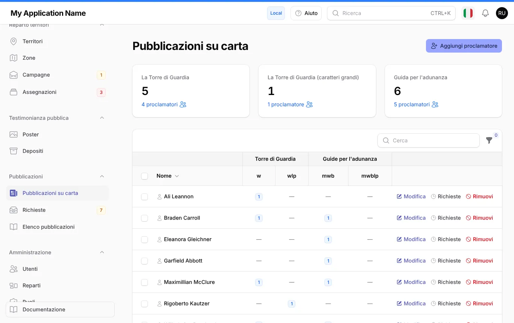
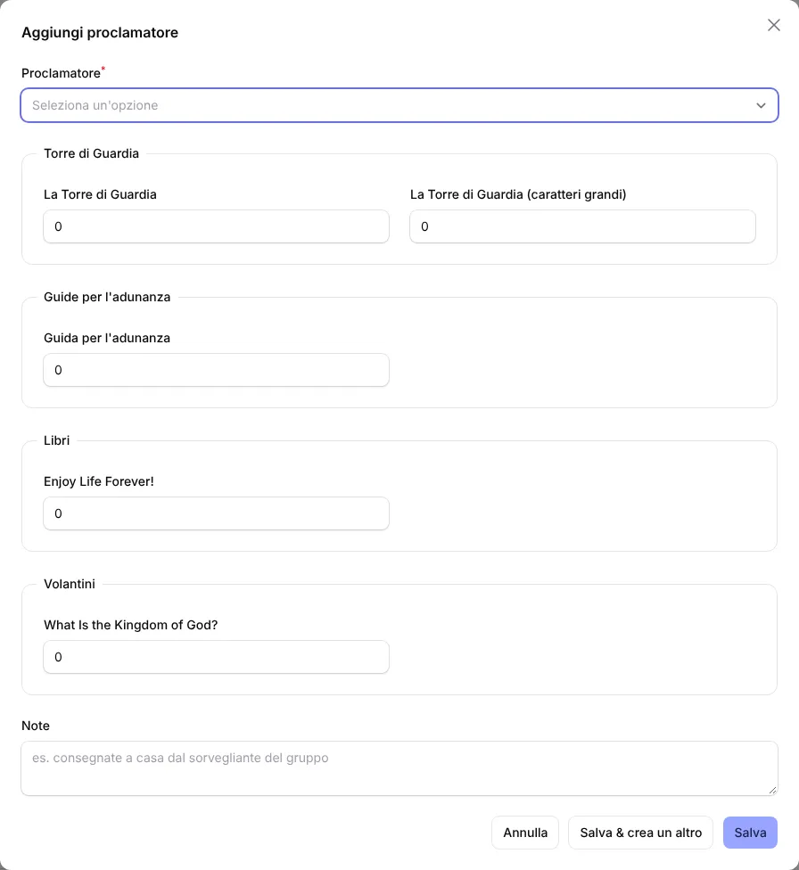

Apri **Pubblicazioni → Pubblicazioni su carta** per vedere chi riceve pubblicazioni su carta (ad esempio *La Torre di
Guardia* o la *Guida per l'adunanza*), e quante copie.

C'è una riga per ogni proclamatore e una colonna per ogni pubblicazione (**—** se non la riceve), raggruppate per
categoria. I riquadri in alto e la riga **Riepilogo** in fondo mostrano il **totale delle copie da ordinare** di ogni
pubblicazione e quanti proclamatori la ricevono. Usa il filtro **Riceve** per vedere solo chi riceve una pubblicazione:
i totali seguono i filtri e la ricerca.

## Aggiungere un proclamatore

1. Clicca **Aggiungi proclamatore**.
2. Scegli il **Fratello o sorella** (sono elencati solo quelli non ancora presenti).
3. Inserisci le copie di ogni pubblicazione, raggruppate per categoria: lascia `0` per quelle che non riceve. Serve
   almeno una copia.
4. Se vuoi, aggiungi delle **Note** (ad esempio chi gliele consegna).
5. Clicca **Salva**, oppure **Salva & crea un altro** per aggiungere più proclamatori di seguito.

Per cambiare le copie clicca **Modifica**; quando un proclamatore non riceve più nulla clicca **Rimuovi**.

## L'elenco delle pubblicazioni

Le pubblicazioni che si possono ricevere non sono fisse: apri **Pubblicazioni → Elenco pubblicazioni** per
aggiungerle, rinominarle o eliminarle. L'elenco parte con *La Torre di Guardia*, la sua edizione a caratteri grandi e
la *Guida per l'adunanza*.

1. Clicca **Nuovo** e inserisci il **Nome** (es. *Svegliatevi!*).
2. Scegli la **Categoria**, come nella Biblioteca online Watchtower: *Bibbie*, *Torre di Guardia*, *Svegliatevi!*,
   *Guide per l'adunanza*, *Libri*, *Opuscoli e brochure*, *Volantini*, *Indici*, *Programmi*, *Manuali e linee guida*
   o *Altro*.
3. Se vuoi, inserisci un **Nome breve** (es. la sigla `lff`), mostrato nell'intestazione della sua colonna.
4. Clicca **Salva**: la pubblicazione avrà la sua colonna e il suo campo nelle pubblicazioni su carta.

Le pubblicazioni sono elencate per categoria; trascinale (col pulsante in alto nella tabella) per cambiarne l'ordine al
suo interno. Per non offrire più una pubblicazione, disattiva **Disponibile**: sparisce dalle pubblicazioni su carta,
ma le copie già inserite vengono conservate. Eliminandola si eliminano anche quelle copie.

I membri del [reparto Pubblicazioni](../administration/departments) possono gestire entrambi gli elenchi.
