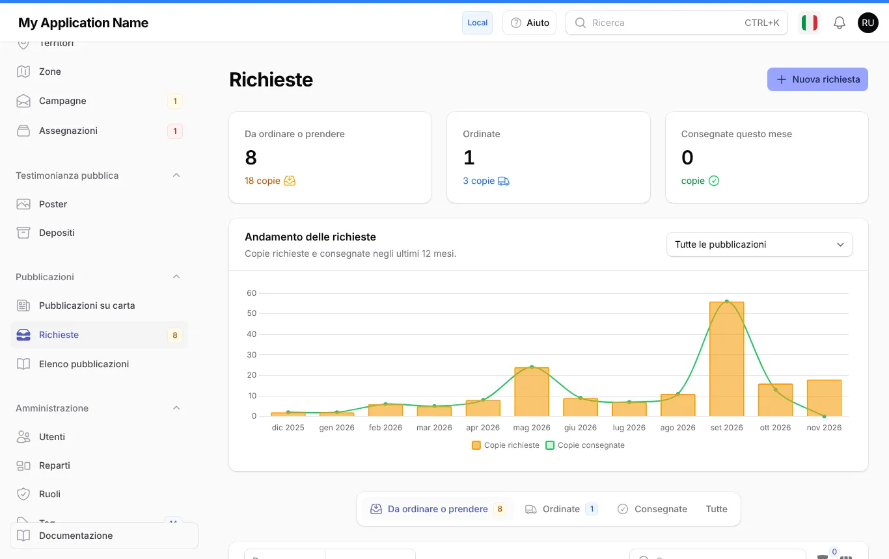
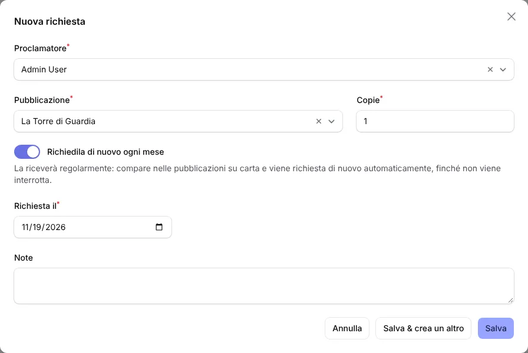

Apri **Pubblicazioni → Richieste** per vedere ogni pubblicazione richiesta dai proclamatori, dalla richiesta alla
consegna, e quando ci sono state più richieste.

Ogni richiesta ha fino a tre passaggi:

1. **Richiesta**: il proclamatore l'ha chiesta;
2. **Ordinata** (facoltativo): è stata ordinata alla filiale. Saltalo quando le copie sono già in deposito;
3. **Consegnata**: le copie sono state consegnate.

Le schede mostrano le richieste **Da ordinare o prendere**, quelle **Ordinate** in attesa di consegna, quelle
**Consegnate**, oppure **Tutte**. Il numero accanto a **Richieste** nel menu indica quante sono ancora da ordinare o
prendere.

## Aggiungere una richiesta

1. Clicca **Nuova richiesta**.
2. Scegli il **Proclamatore**, la **Pubblicazione** e il numero di **Copie**, e controlla la data in cui è stata
   **Richiesta il**.
3. Per una pubblicazione ricevuta regolarmente (es. *La Torre di Guardia*), **Richiedila di nuovo ogni mese** è
   attivo: la pubblicazione viene aggiunta alle [pubblicazioni periodiche](periodicals) del proclamatore e richiesta di
   nuovo automaticamente ogni periodo, finché non viene interrotta; la sua data è in questo mese (per i mesi precedenti
   aggiungi delle richieste singole). Disattivalo per una richiesta singola.
4. Clicca **Salva**, oppure **Salva & crea un altro**.

## Ordinare e consegnare

- Clicca **Ordinata** su una richiesta quando la ordini alla filiale, e **Consegnata** quando la consegni (anche
  direttamente, se era già in deposito). Scegli la data, oggi se non la cambi.
- Per farlo su molte richieste insieme (es. dopo aver inviato l'ordine alla filiale), selezionale e usa le stesse
  azioni dal menu delle righe selezionate.
- **Raggruppa per → Pubblicazione** somma le copie di ogni pubblicazione: nella scheda **Da ordinare o prendere**, è
  l'elenco da ordinare.

## Lo storico

- Il grafico **Andamento delle richieste** mostra le copie richieste (barre) e consegnate (linea) in ognuno degli
  ultimi 12 mesi; scegli una pubblicazione in alto a destra per vedere solo quella.
- Le richieste rinnovate (fatte automaticamente per le pubblicazioni ricevute regolarmente) hanno un'icona con due
  frecce in cerchio nella colonna **Rinnovo**; il filtro **Tipo** mostra solo quelle, o solo le richieste singole.
- Il pulsante **Richieste** di un proclamatore nelle [pubblicazioni periodiche](periodicals), o di una pubblicazione
  nell'**Elenco pubblicazioni**, apre lo storico di quel proclamatore o di quella pubblicazione. Anche la pagina di un
  utente ha la scheda **Richieste pubblicazioni**, come per le sue assegnazioni.

Le richieste rinnovate vengono fatte ogni giorno dallo scheduler dell'applicazione (vedi la
[guida all'installazione](../setup)), il 1° del mese di ogni periodo: un giorno saltato viene recuperato il successivo.

I membri del [reparto Pubblicazioni](../administration/departments) possono gestire le richieste.
