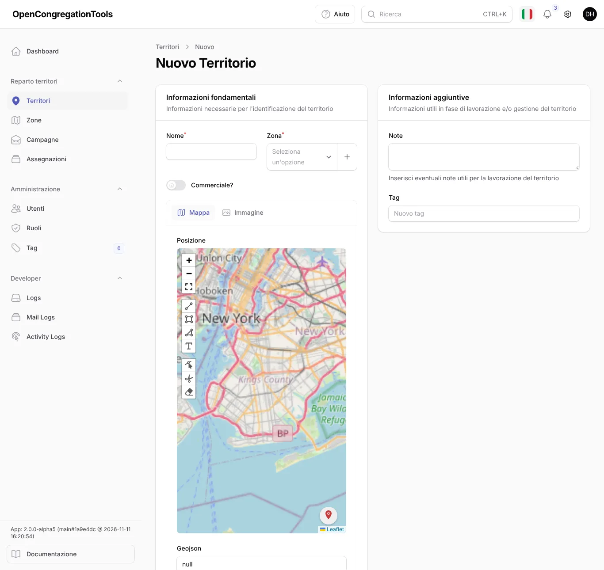
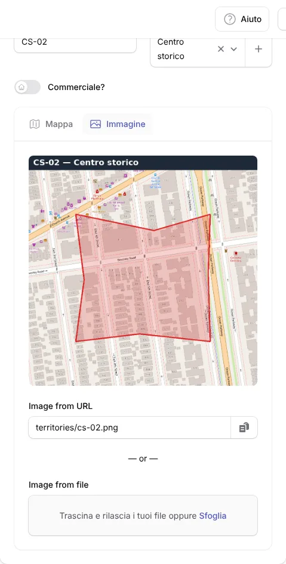

## Creare un territorio

1. Apri **Territori** e clicca **Nuovo**.
2. Compila le **Informazioni fondamentali**:
   - **Nome**: es. `CS-01`. Deve essere unico all'interno della sua zona;
   - **Zona**: scegli una zona esistente, oppure clicca **+** per crearne una nuova senza lasciare la pagina;
   - **Commerciale?**: attivalo per i territori composti da negozi e attività commerciali.
3. Descrivi dove si trova il territorio, con la scheda **Mappa**, la scheda **Immagine** o entrambe (vedi sotto).
4. Se vuoi, compila le **Informazioni aggiuntive**:
   - **Note**: qualsiasi informazione utile a chi lavora il territorio (es. *non suonare al civico 7*);
   - **Tag**: scrivi un tag e premi <kbd>Invio</kbd>. Mentre scrivi vengono suggeriti i tag esistenti; quelli nuovi
     vengono creati automaticamente (vedi [Tag](../administration/tags)).
5. Clicca **Crea**.

> ℹ️ **Nota:** la descrizione del territorio (di solito l'elenco delle sue vie) viene mostrata nei dettagli
> dell'assegnazione ed è usata dalla ricerca, ma al momento si può impostare solo [importando](importing) il territorio.

## Mappa o immagine?

Un territorio può essere descritto in due modi, che possono coesistere:

| | **Mappa** | **Immagine** |
|-|-----------|--------------|
| Cos'è | Una forma disegnata su una mappa interattiva di OpenStreetMap | Un'immagine, es. la foto o la scansione della cartolina cartacea |
| Mostrata nella dashboard | Sì, con il colore della sua zona | No |
| Si può ingrandire e usare per orientarsi | Sì | No |
| Ideale per | I nuovi territori | I territori provenienti dal registro cartaceo |

Il disegno della mappa è descritto in [Disegnare le mappe](maps).

## Aggiungere un'immagine

Nella scheda **Immagine** puoi:

- incollare un link in **Image from URL**, oppure
- trascinare un file su **Image from file** (o cliccare **Sfoglia**). L'editor integrato permette di ritagliare e
  ruotare l'immagine prima di salvarla.

Le due opzioni sono alternative: compilarne una disabilita l'altra. Le immagini caricate sono conservate in modo
privato e possono vederle solo gli utenti che hanno effettuato l'accesso.

## Modificare un territorio

Clicca **Modifica** sulla riga del territorio (o **⋮ → Modifica** nella pagina del territorio), cambia ciò che serve e
clicca **Salva modifiche**. Il pulsante **Elimina** in alto nella pagina di modifica sposta il territorio nel cestino
(vedi [Elenco dei territori](introduction)).
