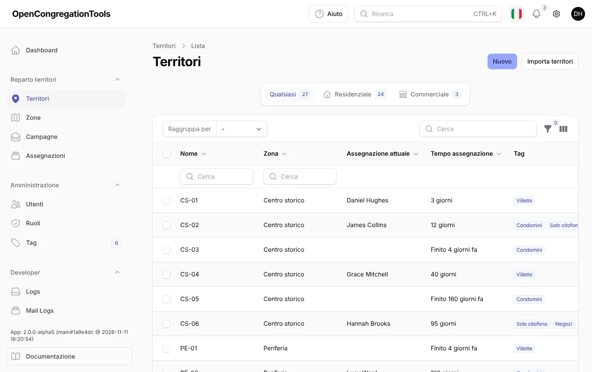
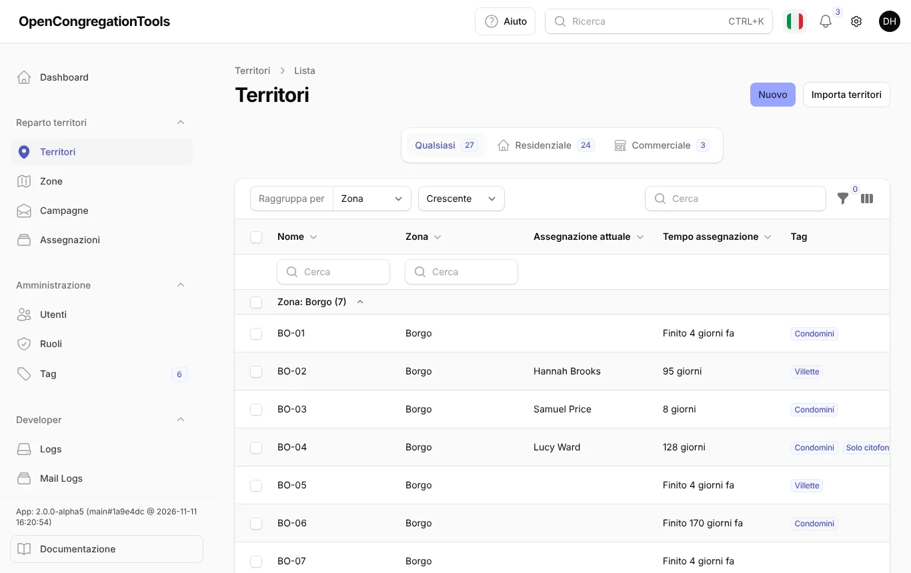
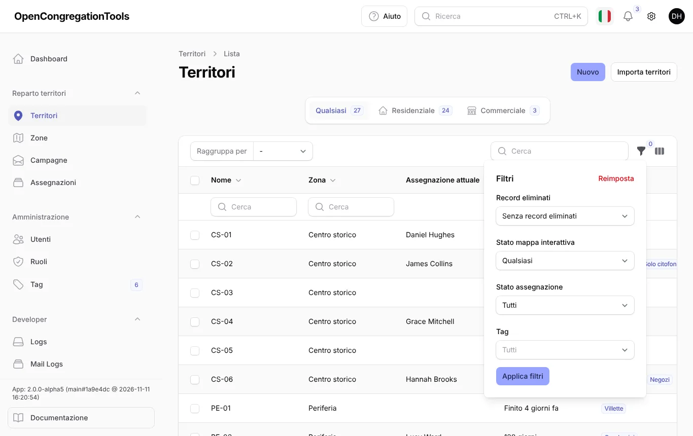
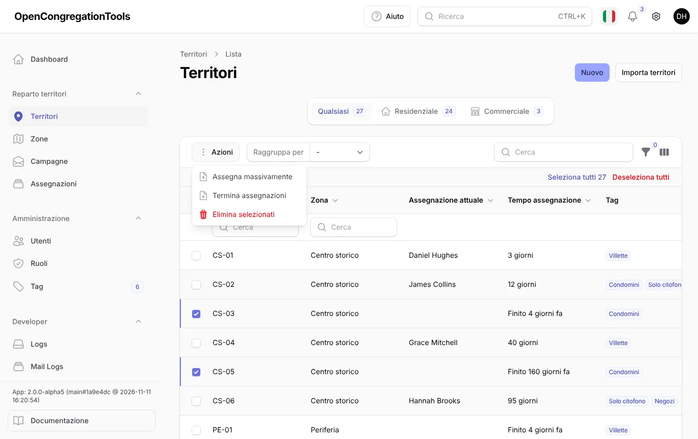
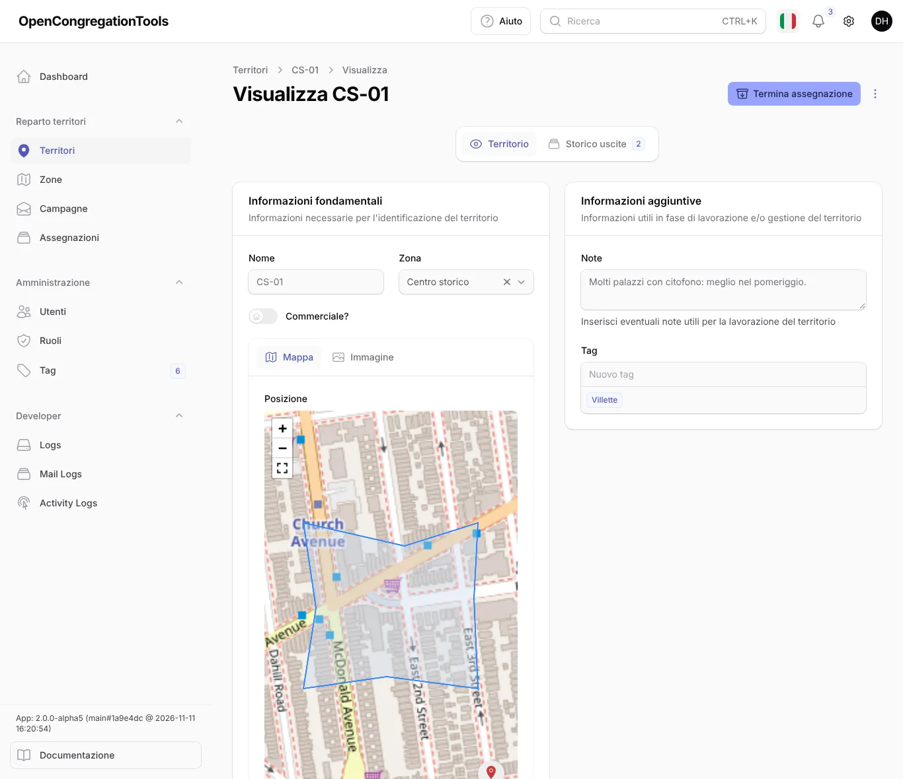
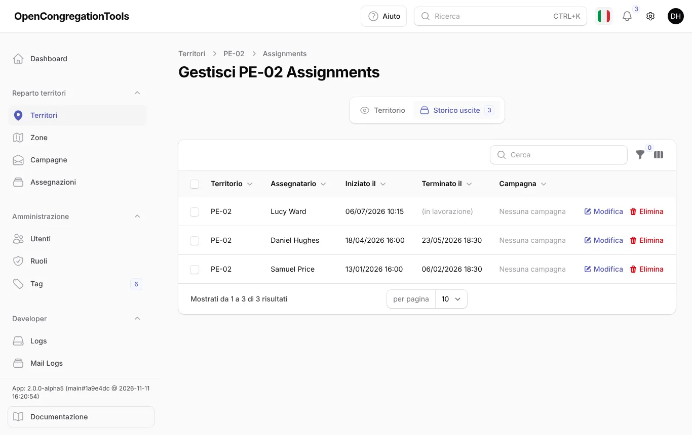

I territori sono la parte principale di questo progetto:

- Possono essere assegnati a un utente, generando una "assegnazione";
- Possono essere descritti da un'immagine o da una mappa (o da entrambe);
- Possono contenere note e tag per facilitarne la ricerca.

Apri **Territori** dalla barra laterale per vederli tutti.

## Creazione di territori

È possibile creare nuovi territori in due modi:

1. **Creare** un nuovo territorio singolarmente, con il pulsante **Nuovo** (vedi
   [Creare e modificare i territori](creating));
2. **Importare** uno o più territori in blocco da un file CSV, con il pulsante **Importa territori** (vedi
   [Importare i territori](importing)).

## Leggere la tabella

| Colonna | Significato |
|---------|-------------|
| **Nome** | Nome del territorio. Clicca la riga per aprirne i dettagli. |
| **Zona** | Zona a cui appartiene il territorio. |
| **Assegnazione attuale** | Chi sta lavorando il territorio in questo momento. Vuota se il territorio è disponibile. |
| **Tempo assegnazione** | Per un territorio fuori: da quanto tempo è fuori (es. *40 giorni*). Per un territorio disponibile: da quanto è stato riconsegnato (es. *Finito 4 giorni fa*). Un trattino indica che non è mai stato assegnato. |
| **Tag** | I tag del territorio. |

Le colonne **Commerciale?**, **Creato il** e **Aggiornato il** sono nascoste: mostrale con il pulsante **Colonne**.

> 💡 **Suggerimento:** ordina per **Tempo assegnazione** per trovare subito i territori fuori da più tempo, oppure
> quelli che non vengono lavorati da molto.

## Territori residenziali e commerciali

Le schede sopra la tabella mostrano i territori **Qualsiasi**, **Residenziale** o **Commerciale**, con il loro numero.

## Ricerca

Usa il campo **Cerca** sopra la tabella per cercare ovunque, oppure i campi sotto le intestazioni **Nome** e **Zona** per
cercare solo in quella colonna.

## Raggruppare

Scegli un valore in **Raggruppa per** per dividere la tabella:

- **Zona**: un gruppo per zona;
- **Campagna**: raggruppa i territori in base alla campagna della loro assegnazione attuale. I territori disponibili,
  e quelli assegnati fuori da una campagna, sono elencati sotto *Nessuna campagna*.

Il titolo di ogni gruppo mostra quanti territori contiene tra quelli che corrispondono alla scheda, ai filtri e alla
ricerca attuali.

Clicca il titolo di un gruppo per chiuderlo o aprirlo.

## Filtri

Clicca il pulsante dei **filtri** (icona a imbuto) per filtrare per:

- **Record eliminati**: mostra o nasconde i territori eliminati (vedi sotto);
- **Stato mappa interattiva**: territori *con* o *senza* mappa;
- **Stato assegnazione**: *Assegnati* (attualmente fuori) o *Non assegnati* (disponibili);
- **Tag**: territori che hanno almeno uno dei tag selezionati.

## Azioni

Su ogni riga:

- **Modifica** apre il modulo di modifica;
- il menu **⋮** contiene **Assegna territorio** (se disponibile) o **Termina assegnazione** (se è fuori), descritte in
  [Assegnare e riconsegnare](../assignments/assigning).

Spunta una o più righe per usare le **azioni di massa**:

- **Assegna massivamente**: assegna tutti i territori disponibili selezionati alla stessa persona;
- **Termina assegnazioni**: riconsegna tutti i territori selezionati che sono fuori;
- **Elimina selezionati**.

## Dettagli del territorio

Clicca una riga per aprire il territorio. La pagina mostra i dati del territorio, con la **Mappa** e l'**Immagine** in
schede separate, e il pulsante **Termina assegnazione** / **Assegna territorio** in alto. Il menu **⋮** contiene
**Modifica**; il pulsante **Elimina** si trova nella pagina di modifica.

Il **Tempo medio di percorrenza** indica quanto tempo serve in media a percorrere il territorio, dall'inizio alla fine
delle sue assegnazioni terminate; le assegnazioni ancora in corso non vengono conteggiate.

La scheda **Storico uscite** elenca tutte le assegnazioni del territorio, dalla più recente. Di default mostra solo
l'assegnazione in corso: rimuovi il filtro *Stato assegnazione* per vederle tutte.

## Eliminare e ripristinare

I territori eliminati non vanno persi: vengono spostati nel cestino. Per recuperarne uno:

1. apri i filtri e imposta **Record eliminati** su *Con record eliminati* o *Solo record eliminati*;
2. apri il menu **⋮** del territorio e clicca **Ripristina**.

**Elimina forzatamente** rimuove un territorio in modo definitivo.

> ⚠️ **Attenzione:** quando una zona viene eliminata, vengono nascosti anche tutti i suoi territori.
