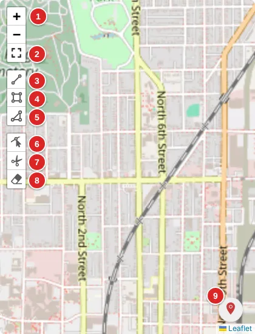
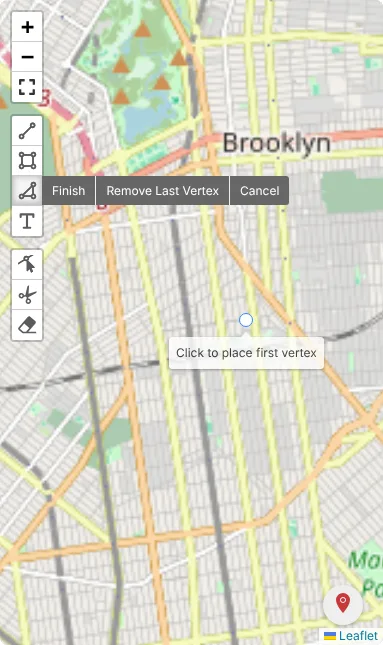

La scheda **Mappa** del modulo del territorio contiene una mappa interattiva su cui disegnare i confini del territorio.

## Trovare la zona

Una nuova mappa si apre sull'area dei territori che hanno già una mappa (su quelli della sua zona, quando crei il
territorio dalla scheda **Territori** di una [zona](zones)), oppure sul **Centro predefinito delle mappe** delle
[impostazioni](../administration/settings) finché nessun territorio ha una mappa. Per raggiungere l'area del
territorio:

- clicca il pulsante di **posizione** (segnaposto rosso, in basso a destra) per centrare la mappa sulla tua posizione
  attuale (la prima volta il browser chiede il permesso), oppure
- usa **+** / **−** o la rotellina del mouse e trascina la mappa nel punto giusto.

## La barra degli strumenti

1. **Zoom avanti / indietro**.
2. **Schermo intero**: ingrandisce la mappa, comodo per disegnare territori grandi.
3. **Draw Polyline**: disegna una linea (es. una via da lavorare).
4. **Draw Rectangle**: clicca e trascina per disegnare un rettangolo.
5. **Draw Polygons**: lo strumento usato per la maggior parte dei territori (vedi sotto).
6. **Edit Layers**: trascina i vertici delle forme esistenti per correggerle.
7. **Cut Layers**: disegna una forma per ritagliarla da una esistente (es. per escludere un parco).
8. **Remove Layers**: clicca una forma per eliminarla.

## Disegnare un poligono

1. Clicca **Draw Polygons** (5).
2. Clicca sulla mappa per posizionare il primo vertice, poi clicca su ogni angolo del territorio, seguendo le strade.
3. Per chiudere la forma clicca di nuovo il primo vertice, oppure clicca **Finish**. **Remove Last Vertex** annulla
   l'ultimo clic, **Cancel** scarta la forma.
4. Salva il territorio.

> 💡 **Suggerimento:** aumenta lo zoom prima di disegnare, così i vertici seguono le strade con precisione. Puoi sempre
> correggerli in seguito con **Edit Layers**.

> ℹ️ **Nota:** le aree e le linee vengono mostrate ovunque il territorio viene usato: nella pagina dell'assegnazione,
> nella pagina pubblica di un'[assegnazione condivisa](../assignments/sharing) e nella mappa della
> [dashboard](../basics/dashboard).

Le forme disegnate vengono salvate in formato GeoJSON (mostrato nel campo **Geojson** sotto la mappa). Se hai molte
mappe già pronte, puoi caricarle tutte insieme con l'[importazione](importing), che accetta una colonna GeoJSON.
