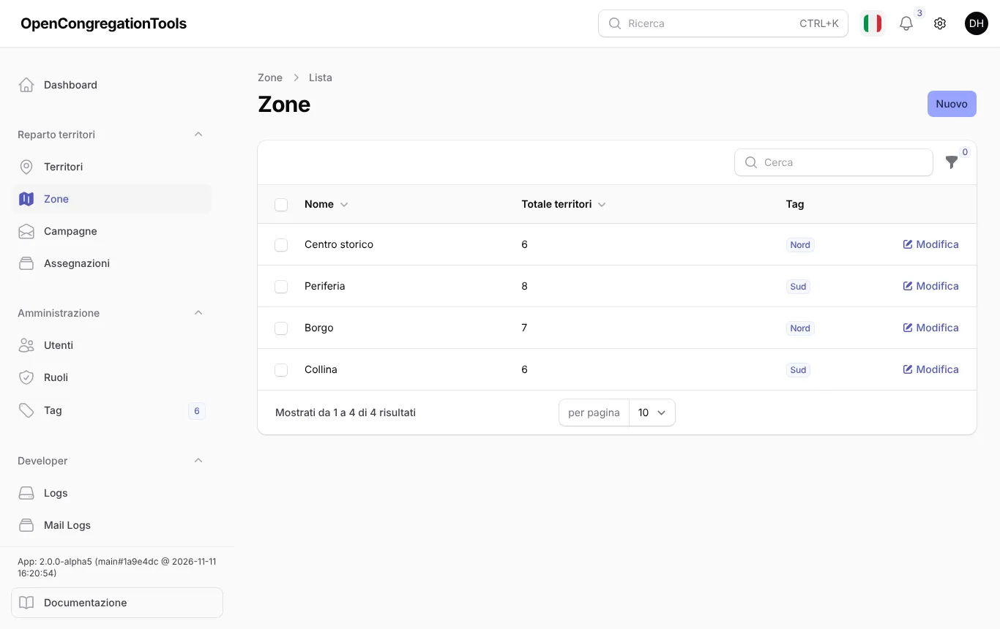
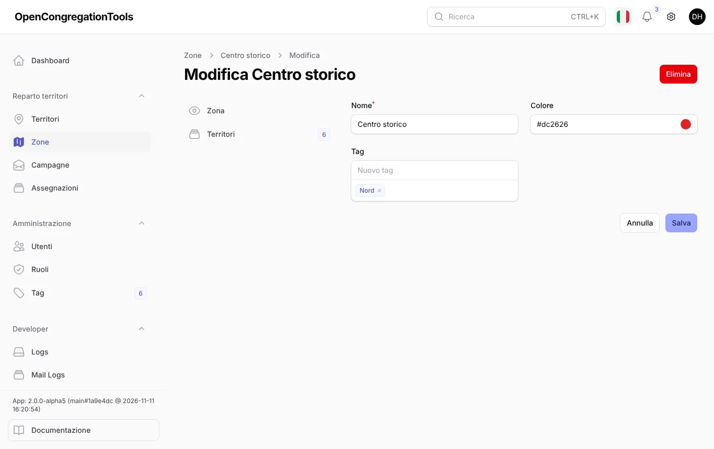
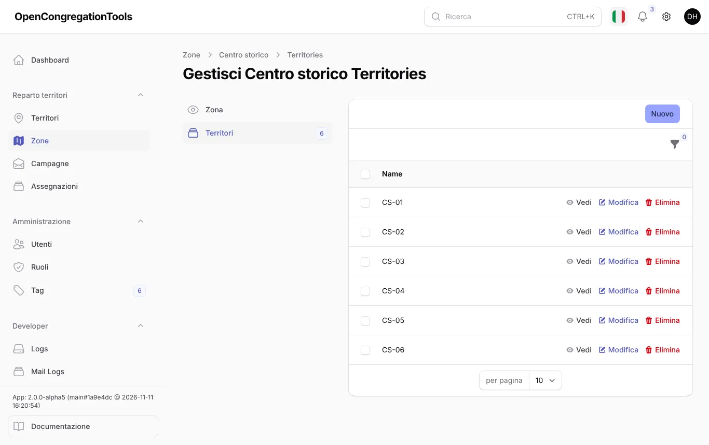

Le zone raggruppano i territori, di solito per quartiere. Ogni territorio appartiene a una sola zona. Apri **Zone**
dalla barra laterale per vederle, con il numero di territori e i tag di ciascuna.

## Creare una zona

1. Clicca **Nuovo**.
2. Inserisci il **Nome** e scegli un **Colore**: viene usato per disegnare i territori della zona nella mappa della
   dashboard.
3. Se vuoi, aggiungi dei **Tag** (es. *Nord*, *Sud*).
4. Clicca **Crea**.

Puoi creare una zona anche direttamente dal modulo del territorio, con il pulsante **+** accanto al campo **Zona**.

## Territori di una zona

Apri una zona e clicca la scheda **Territori** per vederne i territori. Da qui puoi anche creare un nuovo territorio
direttamente in questa zona, e visualizzare, modificare o eliminare quelli esistenti.

## Filtri

Il filtro **Tag** mostra solo le zone con i tag selezionati. Il filtro **Record eliminati** mostra anche le zone
eliminate, per ripristinarle con **Ripristina**.

> ⚠️ **Attenzione:** una zona che contiene ancora dei territori non può essere eliminata: prima spostali in
> un'altra zona o eliminali. Per eliminare una zona definitivamente (**Forza eliminazione**), anche i suoi territori
> eliminati devono prima essere spostati o eliminati definitivamente.
